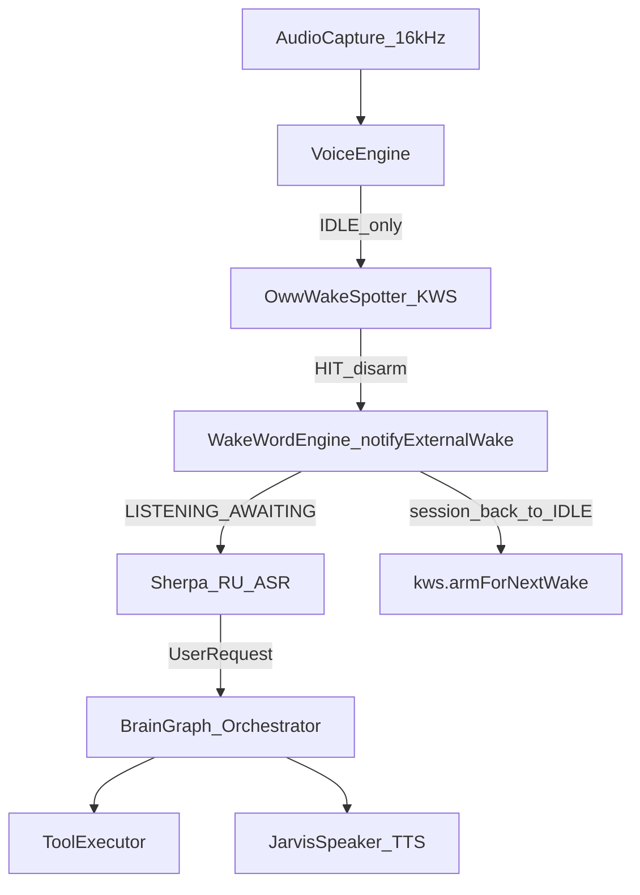

# Jarvis Android — полный handoff (2026-09-29)

Документ для передачи другому ИИ: **актуальное состояние кода**, архитектура, последние изменения (особенно wake word), известные дыры и куда двигаться дальше.

- Бюджет: **строго 0 ₽**, только OSS / бесплатные API без ключей.
- Целевое устройство: **Xiaomi 23117RA68G (Helio G99 / MT6789), HyperOS 3, Android 16** — см. [`DEVICE_SPECS.md`](../DEVICE_SPECS.md).
- Пакет: `com.jarvis.assistant` · namespace app: `com.jarvis.app`.
- Сборка: `./gradlew :app:assembleDebug` (JDK 17).

### Связанные доки (не дублировать целиком)

| Файл | Роль |
|------|------|
| [`md_files/JARVIS_HANDOFF_STATUS.md`](JARVIS_HANDOFF_STATUS.md) | Предыдущий handoff (2026-09-18+); частично устарел по wake |
| [`md_files/COMPANION_STATUS.md`](COMPANION_STATUS.md) | Companion / Stage 8A–8B |
| [`jarvis-full-roadmap.md`](../jarvis-full-roadmap.md) | Активная roadmap фаз 0–7 |
| [`md_files/JARVIS_MASTER_ROADMAP_v2.md`](JARVIS_MASTER_ROADMAP_v2.md) | Длинная визия |
| [`SMOKE_RESULTS.md`](../SMOKE_RESULTS.md) | Phase 0 device smoke |
| [`CHANGELOG.md`](../CHANGELOG.md) | Ранние этапы 0–4 (до 2026-09-14); **не отражает** сентябрьский wake rewrite |
| Этот файл | **Источник правды на 2026-09-29** по голосу/wake + сводка всего проекта |

---

## 1. Что это за продукт

Офлайн-first голосовой ассистент на Android:

```
mic → wake (KWS) → ASR (команда) → Brain (rules + LLM) → tools / a11y UI → TTS
```

- Сеть только для погоды / знаний / части музыки по необходимости.
- «Руки» через Accessibility + NotificationListener + системные Intent/API.
- Один процесс-wide голосовой пайплайн: `VoiceController` / `VoiceEngine` (не два параллельных слушателя).

---

## 2. Модули Gradle

`settings.gradle.kts` → rootProject `jarvis`:

| Модуль | Назначение |
|--------|------------|
| `:app` | UI (Dashboard), `VoiceService`, `VoiceEngine`, `BrainGraph`, онбординг, companion UI |
| `:core` | Intent/Tool модели, policy, registry, conversation/memory, autonomy contracts |
| `:brain` | `RuleBasedBrain`, `LlmBrain`, `AssistantOrchestrator`, `DialogueResponder` |
| `:tools` | Все tool-реализации (фонарик, музыка, SMS, UI, Telegram…) |
| `:screen-control` | AccessibilityService, ScreenController, NotificationListener |
| `:asr-engine` | Sherpa RU streaming, EN buffer, offline multilingual refine |
| `:tts-engine` | Офлайн TTS |
| `:audio-engine` | `AudioCapture` (16 kHz PCM) |
| `:wakeword-engine` | openWakeWord KWS «Джарвис» + `WakeWordEngine` (ASR команд после wake) |
| `:overlay-ui` | Overlay orb |
| `:background-service` | FG service helpers |
| `:connectivity-router` | Сеть/маршрутизация |
| `:permissions-onboarding` | Пермишены / HyperOS |

---

## 3. Архитектура голосового пайплайна (актуально)



### 3.1 Точки входа

| Компонент | Путь | Роль |
|-----------|------|------|
| `VoiceService` | `app/.../VoiceService.kt` | FGS (microphone), создаёт `VoiceEngine`, гоняет Brain на requests |
| `VoiceController` | `app/.../VoiceEngine.kt` (object) | Единый владелец mic/engine на процесс |
| `VoiceEngine` | тот же файл | Capture → KWS / ASR → wake/request events |
| `DebugCommandReceiver` | `app/.../DebugCommandReceiver.kt` | Только **debug**: `DEBUG_VOICE` / `DEBUG_COMMAND` по ADB |
| Dashboard | `app/.../DashboardActivity.kt` | Старт/стоп голоса с UI |

Launcher activity: `com.jarvis.assistant/com.jarvis.app.DashboardActivity`.

### 3.2 Режимы

| Режим | Поведение |
|-------|-----------|
| Обычный + wake on | IDLE = **только KWS**; после HIT — ASR для команды; снова IDLE → `armForNextWake` |
| Live / wake off | Непрерывный ASR без wake |
| KWS init fail | Wake **не** откатывается на ASR-wake (осознанно) |

**Важно:** ASR **не** используется для детекции wake. ASR только после KWS HIT (и в live).

### 3.3 Состояния `WakeWordEngine`

`IDLE → LISTENING → AWAITING_COMMAND → IDLE`

- `notifyExternalWake()` — внешний KWS HIT.
- `onAudioChunk()` — только когда не IDLE (команда).
- В unit-тестах у `WakeWordEngine` ещё есть legacy ASR-текстовый wake (fuzzy «джарвис») — **в прод IDLE-пути VoiceEngine это не вызывается**.

---

## 4. Wake word — последние изменения (2026-09-28…29)

### 4.1 Что было не так (контекст)

1. Picovoice / английский sherpa KeywordSpotter — отброшены (краши / не RU).
2. Гибрид KWS+ASR wake — ASR будил сам, KWS скоры ~0; пользователь запретил ASR в wake.
3. Неверный mel/embedding indexing и несовпадение embedding MD5 ломали классификатор.
4. После HIT старый feature-buffer давал **мгновенный повторный wake**; AGC на тишине разгонялся до ~13× и **клиппил** речь в упор.

### 4.2 Что сделано сейчас

Переписан модуль с нуля:

| Файл | Роль |
|------|------|
| [`OwwAudioFeatures.kt`](../wakeword-engine/src/main/kotlin/com/jarvis/wakeword/OwwAudioFeatures.kt) | 1:1 порт openWakeWord `AudioFeatures` (mel → embedding 96-d, chunk 1280) |
| [`OwwWakeSpotter.kt`](../wakeword-engine/src/main/kotlin/com/jarvis/wakeword/OwwWakeSpotter.kt) | Классификатор `djarvis.onnx`, AGC, adaptive thr, arm/disarm |
| [`WakeWordEngine.kt`](../wakeword-engine/src/main/kotlin/com/jarvis/wakeword/WakeWordEngine.kt) | Пост-wake ASR команд (не KWS) |
| [`VoiceEngine.kt`](../app/src/main/kotlin/com/jarvis/app/VoiceEngine.kt) | Wiring: IDLE=KWS only |

Удалён старый `DjarvisKwsSpotter.kt`.

### 4.3 Модели и native

**Assets** `app/src/main/assets/openwakeword/`:

| Файл | MD5 (актуальный) | Назначение |
|------|------------------|------------|
| `melspectrogram.onnx` | `763f67cda797…` | Mel |
| `embedding_model.onnx` | `7602421d736d…` | Из user zip `wake model/openwakeword_pipeline_models.zip` (не pip-пакет `1498ebfe…`) |
| `djarvis.onnx` | `5673a68b66a2…` | Классификатор «Джарвис» |
| `djarvis.tflite` | `2916607072ff…` | Лежит в assets; **рантайм сейчас ONNX** |

Исходники пользователя: папка [`wake model/`](../wake%20model/) (`Джарвис_20260815_123547.{onnx,tflite}`, zip пайплайна).

**JNI** `app/src/main/jniLibs/arm64-v8a/`:

- `libonnxruntime.so` — sherpa ASR  
- `libonnxruntime_oww.so` — Microsoft ORT для OWW (отдельный soname)  
- `libonnxruntime4j_jni.so` — JNI к OWW ORT  

Spotter: `System.loadLibrary("onnxruntime_oww")` + `onnxruntime4j_jni`.

### 4.4 Жизненный цикл KWS

```
armed + IDLE → process(PCM)
  → HIT → disarm (KWS молчит)
  → WakeWordEngine LISTENING (ASR команда)
  → … команда / TTS / busy …
  → обратно IDLE → armForNextWake(cooldown ~700 ms, reset features)
```

- Во время cooldown `process` **кормит** фичи, но не стреляет HIT.
- Громкая речь: AGC почти 1× (не клиппить в упор).
- Тихая/дальняя: boost до ~8× по пику.

### 4.5 Пороги чувствительности (UI: low=0 / medium=1 / high=2)

В [`JarvisSettings`](../app/src/main/kotlin/com/jarvis/app/JarvisSettings.kt) дефолт **high (2)**.

| Level | Базовый thr | Примечание |
|-------|-------------|------------|
| 0 low | 0.12 | Строже |
| 1 medium | 0.06 | `DEFAULT_THRESHOLD` |
| 2 high | **0.02** | + adaptive floor `MIN_TRIGGER=0.015` в тишине |

Смена чувствительности в Dashboard **рестартует** `VoiceController` (иначе старый thr в памяти).

### 4.6 Статус wake по мнению пользователя (на момент handoff)

- «Стало сильно лучше» после снижения thr + window peak + AGC fix.
- «Пока пойдёт» — дальнейший тюнинг wake **не приоритет**.
- Возможны редкие пропуски / ложные при thr=0.02; не трогать без явной просьбы.

### 4.7 Логи / отладка wake

```bash
adb logcat -s Jarvis.KWS:I Jarvis.OWW.Features:I Jarvis.VoicePipeline:I
# HIT, score/win/peak, thr=, agc=Nx, armed=
```

Тег VoiceEngine: **`Jarvis.VoicePipeline`**.

---

## 5. ASR / TTS / Audio (кратко)

| Компонент | Детали |
|-----------|--------|
| Capture | [`AudioCapture`](../audio-engine/src/main/kotlin/com/jarvis/audio/AudioCapture.kt): 16 kHz mono, chunk 100 ms, `AudioSource.MIC`, float ≈[-1,1] |
| RU streaming | Sherpa zipformer small RU (assets → `files/models/…`) |
| EN | `BufferedEnAsr` — второй проход после endpoint |
| Offline multi | `OfflineMultilingualAsr` при наличии модели |
| Выбор текста | `CommandTextSelector` (RU streaming + multi + EN) |
| TTS | `JarvisSpeaker` + `:tts-engine`; mic глушится на `speaking` + ~220 ms хвост |

Модели качаются вкладкой **Модели** (`ModelManager` → `files/models/`).

---

## 6. Brain и tools

### 6.1 Composition

[`BrainGraph`](../app/src/main/kotlin/com/jarvis/app/BrainGraph.kt) → `AssistantOrchestrator` + router:

- `RuleBasedBrain` — deterministic-first  
- `LlmBrain` — если включён LLM и есть GGUF  
- `DialogueResponder` — чат/follow-up (шаблоны → ChatLlm → hint)

Chat LLM: Qwen ~1.5B GGUF через llama.cpp AAR (`LlamaChatLlmEngine`).

### 6.2 Tools (`:tools`)

flashlight, volume, brightness, timer, calendar, sms, launcher, phone.call, contacts, files.search, system.setting, notifications, clipboard, screenshot, ui.click/type/swipe/global/read/**wait**, weather, music, knowledge, telegram send, …

Policy: risk levels + confirm для чувствительных действий.

---

## 7. UI (Dashboard)

Нижние вкладки:

| Index | Имя | Layout |
|-------|-----|--------|
| 0 | ГЛАВНАЯ | `screen_home` |
| 1 | LIVE | `screen_live` — **vision/camera stub** («в разработке») |
| 2 | ПАМЯТЬ | `screen_memory` |
| 3 | КОМАНДЫ | `screen_skills` |
| 4 | ЕЩЁ | settings → sub: main / **Модели** / **Companion** |

---

## 8. Companion / Autonomy

См. [`COMPANION_STATUS.md`](COMPANION_STATUS.md).

| Stage | Статус |
|-------|--------|
| Perception / PhoneContext / observers | Есть |
| Memory / Behavior / Proactive (decision-only) | Частично / UI |
| 8A Autonomy contracts | Done (stub блокирует premature ALLOW) |
| 8B ActionRiskClassifier | Done |
| **8C AutonomyPolicy** | **Done** — `DefaultAutonomyPolicy` + `CompanionProactive.evaluateAutonomy` |
| **8D ActionSafetyGate** | **Done** — `DefaultActionSafetyGate` (dryRun default) + `AutonomyAuditLog` |
| **8E–8F adapter / first action** | **Done** — mapper + pipeline + `SafeAutonomousExecutor` (flashlight/volume/brightness, opt-in live) |

**Граница:** proactive tick **не** exec; live только через `DEBUG_AUTONOMY` / явный `trySafeExecute`. SMS/calls = 0 autonomous.

---

## 9. Известные дыры (актуальный список)

### Голос
- Wake: accepted «пока ок»; thr агрессивный (high=0.02) — возможны FP.
- ASR команд / refine / glue — в целом по Phase 0 smoke PASS; следить за endpoint.
- TTS latency / SLO first-audio ≤1 с — **цифры PENDING** (логи `slo1s` есть).
- FGS microphone: старт с фона (чистый ADB broadcast) на HyperOS может падать без foreground — запускать голос с UI.

### Hands / tools
- Telegram-like: нужен повторный smoke ×5.
- SAF / files — слабо.
- Music: внутренний плеер отменён; Kion/`PLAY_FROM_SEARCH` — partial / UI flash.
- Chat ответы часто шаблонные; ReAct quality — нужен smoke.

### Companion
- Нет автономного исполнения.
- UsageStats / Learning / full Autonomy — не завершены.

### Отложено roadmap
- OCR fallback (код ScreenOcr есть, Phase 3 paused).
- Embeddings / notes / automations / widgets.
- Spotify OAuth.

---

## 10. Куда двигаться дальше (рекомендации)

Пользователь **явно**: wake пока не трогать; двигаться дальше. Направление **не выбрано** в чате — следующий агент должен **спросить приоритет**, если не указан.

Логичные кандидаты (по ценности для ежедневного использования):

1. **Голос после wake** — качество ASR команд, быстрее TTS / first-audio, меньше глюков endpoint.  
2. **Hands reliability** — Telegram, confirm звонков/SMS, UI automation smoke.  
3. **Chat LLM / диалог** — меньше шаблонов, follow-up, latency LLM.  
4. **Companion confirm UI** — suggestion → confirm → `trySafeExecute`; media/launcher с confirm.  
5. **Стабильность** — device smoke, HyperOS FGS/пермишены, не новые фичи.

Устаревший «строгий» порядок из старого handoff (Phase 0 → music-engine → …) **частично неактуален**: Phase 0 practically closed, music-engine **отменён**. Companion A→B→C→8C–8F foundation выполнен.

---

## 11. Как собрать / поставить / смоук

```bash
export JAVA_HOME=/usr/lib/jvm/java-17-openjdk-amd64   # или свой JDK 17
cd /path/to/Jarvis_for_android
./gradlew :app:assembleDebug
adb install -r app/build/outputs/apk/debug/app-debug.apk
adb shell pm grant com.jarvis.assistant android.permission.RECORD_AUDIO
adb shell am start -n com.jarvis.assistant/com.jarvis.app.DashboardActivity
```

Debug voice (после UI-старта / с foreground):

```bash
adb shell am broadcast \
  -a com.jarvis.assistant.DEBUG_VOICE \
  -n com.jarvis.assistant/com.jarvis.app.DebugCommandReceiver \
  --es action start
```

Phase 0 smoke: `./scripts/smoke_phase0.sh` → [`SMOKE_RESULTS.md`](../SMOKE_RESULTS.md).

Онбординг: a11y + notification listener + battery unrestricted + overlay по необходимости.

---

## 12. Правила для следующего агента

1. **Не ломать** wake KWS путь без просьбы; не возвращать ASR-wake в IDLE.  
2. Не коммитить секреты; бюджет 0 ₽.  
3. Не начинать OCR / music-engine / risky autonomous exec (SMS/calls) без явного OK. 8E/8F — только safe local actions.  
4. Держать один `VoiceController` — никаких вторых mic listeners.  
5. Embedding для OWW — **zip** MD5 `7602421d…`, не подменять pip-пакетом без ретрейна классификатора.  
6. После смены wake sensitivity нужен рестарт voice pipeline (UI уже рестартит).  
7. Писать изменения в этот handoff или `CHANGELOG.md`, если существенно меняется поведение.

---

## 13. Краткая хронология последних сессий (wake)

| Когда | Что |
|-------|-----|
| ~2026-09-28 | Модели «Джарвис» в `wake model/`; попытки OWW на Android |
| | ORT sherpa vs Microsoft → `libonnxruntime_oww.so` |
| | Фикс mel window indexing; embedding MD5 mismatch |
| 2026-09-29 | Полный rewrite: `OwwAudioFeatures` + `OwwWakeSpotter`; VoiceEngine KWS-only IDLE |
| | Баг повторного wake → arm/disarm + reset features |
| | Тюнинг thr / AGC / adaptive; пользователь: «сильно лучше», «пока пойдёт» |
| | Запрос плана дальше → затем этот handoff MD |

---

*Конец handoff 2026-09-29. При конфликте с [`JARVIS_HANDOFF_STATUS.md`](JARVIS_HANDOFF_STATUS.md) по wake/голосу — верить этому файлу.*

---

## 14. Increment A — LLM Core Hardening (2026-09-29, после handoff)

Выполнено по заданию «AI-компаньон / LLM Core» (wake **не** трогали):

| Изменение | Файлы |
|-----------|--------|
| Structured decision (`ANSWER`/`QUESTION`/…) + parser | `brain/.../LlmStructuredDecision.kt` |
| `ChatLlmEngine.decide()` | `brain/.../ChatLlmEngine.kt` |
| **LLM-first** диалог; шаблоны только без модели / fallback | `brain/.../DialogueResponder.kt` |
| Lazy-load в `generate`/`decide`; anti-hallucination system prompt; latency logs | `app/.../LlamaChatLlmEngine.kt` |
| Lazy `LlmBrain.initialize()` на первом ambiguous route | `brain/.../LlmBrain.kt` |
| `dialogue Nms` в orchestrator; `orch=` в VoiceService brain log | `AssistantOrchestrator.kt`, `VoiceService.kt` |
| Unit tests parser + LLM-first | `DialogueResponderTest.kt` |

**Следующий этап (B):** Capability Registry над существующими tools — без переписывания Voice/Wake.

---

## 15. Increment B — Capability Layer (2026-09-29)

Слой **Capability** над существующими tools (tools не удалялись).

| Компонент | Путь |
|-----------|------|
| Models / Call / Result | `core/.../capability/CapabilityModels.kt` |
| Registry | `CapabilityRegistry.kt` |
| Discovery (subset для LLM) | `CapabilityDiscovery.kt` |
| Executor + Verifier | `CapabilityExecutor.kt` |
| Tool → Capability catalog | `ToolCapabilityCatalog.kt` |
| Aware ToolExecutor | `CapabilityAwareToolExecutor.kt` |
| Wiring | `BrainGraph` + `AssistantOrchestrator.capabilityDiscovery` |
| Tests | `core/.../CapabilityLayerTest.kt` |

Примеры id: `DEVICE_LIGHT`←flashlight, `COMMUNICATION_CALL`←phone.call, `KNOWLEDGE_LOOKUP`←knowledge, `SYSTEM_CONFIGURATION`←system.setting.

Выполнение по-прежнему через tools; результат помечается `capabilityId` / `verified`. Discovery логирует релевантный subset (`Jarvis.Capability`).

**Следующий этап (C):** AutonomyPolicy 8C — выполнен (см. §16).

---

## 16. Increment C — AutonomyPolicy 8C (2026-09-29)

Детерминированная policy поверх 8B risk; **без ToolExecutor / Android API**.

| Компонент | Путь |
|-----------|------|
| `DefaultAutonomyPolicy` | `core/.../autonomy/DefaultAutonomyPolicy.kt` |
| Unit tests | `DefaultAutonomyPolicyTest.kt` (SAFE_ONLY allow flashlight; SMS never silent ALLOW; blocklist; OFF; allowlist→confirm) |
| Companion adapter | `CompanionProactive.evaluateAutonomy` + `DefaultAutonomyPolicy` |

Инварианты: confidence ≠ ALLOW для HIGH/CRITICAL; allowlist HIGH/CRITICAL → confirm only; OFF → DENY.

**Следующий этап (D):** `ActionSafetyGate` 8D — выполнен (см. §17).

---

## 17. Increment D — ActionSafetyGate 8D (2026-09-29)

Финальный harden-gate; **без ToolExecutor**.

| Компонент | Путь |
|-----------|------|
| `DefaultActionSafetyGate` | `core/.../autonomy/DefaultActionSafetyGate.kt` |
| `AutonomyAuditLog` | `AutonomyAuditLog.kt` |
| Tests | `DefaultActionSafetyGateTest.kt` |
| Wire | `CompanionProactive` — policy → gate (`dryRun=true` по умолчанию) |

Инварианты: не ослабляет DENY; HIGH/CRITICAL ALLOW → DENY; MEDIUM → confirm; dryRun блокирует даже LOW ALLOW.

**Следующий этап (E/F):** выполнен (см. §18).

---

## 18. Increment E/F — Adapter + first safe action (2026-09-29)

| Компонент | Путь |
|-----------|------|
| `ProposedActionMapper` | tool / capability / patternKey → ProposedAction |
| `AutonomyActionPipeline` | policy+gate → plan (DRY_RUN_READY / READY_TO_EXECUTE) |
| `SafeAutonomousExecutor` | только flashlight/volume/brightness |
| Debug | `DEBUG_AUTONOMY` (`flashlight_on`, `live=true`) |
| Wire | `BrainGraph` attach dry-run; `CompanionProactive.trySafeExecute` |

Proactive `tick` **не** вызывает executor. SMS/calls denied.

**Следующий этап:** confirm UI → safe exec; затем media/launcher с confirmation.
